# Введение

Ненаправленное ВЭЖХ-МСВР профилирование мочи даёт для каждого образца тысячи сигналов. В типичном клиническом исследовании этому противостоят десятки или первые сотни образцов. Такое соотношение числа переменных и наблюдений делает поиск «маркеров» уязвимым для систематических ошибок. Различия между группами легко получить там, где их источник не связан с заболеванием.

На предыдущих этапах работы был выявлен ряд таких источников. По опыту обработки двух экспериментальных выборок их можно свести к шести.

1. **Неравномерность групп по полу и возрасту.** Пол и возраст сами по себе влияют на экскрецию стероидов, креатинина и продуктов мышечного обмена.
2. **Экзогенные сигналы.** Сюда относятся метаболиты лекарств, компоненты пищи, табака, а также вещества, попадающие в пробу из контейнеров и расходных материалов. Их содержание отражает условия жизни, лечения и сбора проб, а не патологический процесс.
3. **Множественность ионов одного соединения.** Аддукты, изотопы и фрагменты источника ионизации одного соединения многократно учитываются, если их не объединить.
4. **Утечка информации при построении классификаторов.** Если признаки отбирают на всей выборке, а затем оценивают модель кросс-валидацией, оценка точности завышается.
5. **Отсутствие поправки на множественные сравнения.** При тысячах тестов номинальный порог p < 0.05 даёт сотни ложноположительных результатов.
6. **Ошибки аннотации.** Сюда относятся несоответствие брутто-формулы наблюдаемому m/z, неверный тип иона, изобарные соединения.

В настоящей главе описан разработанный фреймворк — набор процедур и программная реализация. Он последовательно учитывает перечисленные источники ошибок и обеспечивает устойчивое построение классификационных моделей и консервативный отбор соединений — потенциальных биомаркеров. Фреймворк апробирован на двух выборках образцов мочи:

- **выборка s266:** рак мочевого пузыря (РМП), рак предстательной железы (РПЖ) и контрольная группа, n = 94;
- **выборка s107:** РМП и контрольная группа, 107 образцов, из которых 82 входили в выборку первого этапа.

Он также использован для проверки достоверности маркеров, предложенных в предыдущих обработках этих же данных.

# 1. Архитектура фреймворка

Фреймворк реализован на языке Python 3.13 (NumPy 2.5, pandas 3.0, SciPy 1.18, statsmodels 0.15, scikit-learn 1.9, Matplotlib 3.11, pyteomics 4.7, mummichog 2.7.0). Обработка полностью воспроизводима: все параметры собраны в одном конфигурационном файле (`pipeline/config.py`), а результаты получаются одной командой (`python run_all.py`). Для второй выборки используется та же команда с переменной окружения `METAB_DATASET=s107`. Исходный код приведён в приложении Г, структура модулей — в приложении Б.

Общая схема обработки показана на рисунке 1. Каждый этап реализован отдельным модулем и протоколируется в файле журнала, где фиксируются число признаков после каждого фильтра, параметры нормализации, исключённые образцы и т. п.

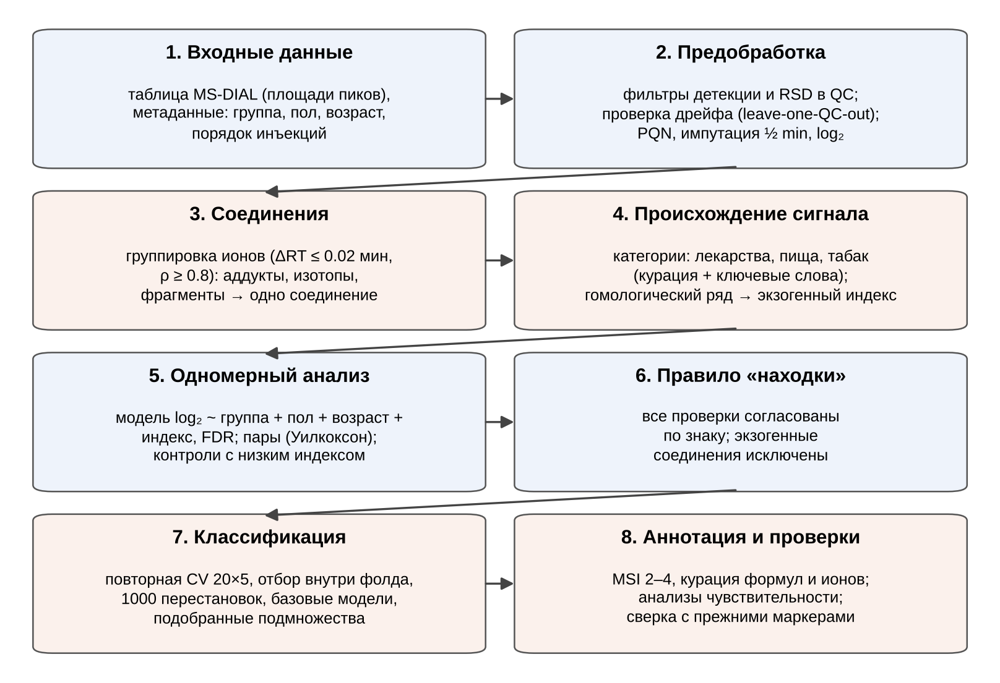{width=16.5cm}

## 1.1. Входные данные и метаданные

На вход подаются:

- **таблица площадей пиков, экспортированная из MS-DIAL.** Строки — образцы, столбцы — признаки вида «время удерживания_m/z_аннотация»; аннотации ниже порога идентификации помечены «low score»;
- **таблица метаданных:** группа, пол, возраст, признак включения в анализ и причина исключения, порядок инъекций.

Образцы с диагнозами вне дизайна исследования исключаются явно, с указанием причины (например, рак почки или поджелудочной железы в выборке s266; опухоль мочеточника и гиперплазия гнёзд Брунна, помеченные в исходной таблице как РМП, в выборке s107). Образцы контроля качества (QC) и бланки распознаются по имени.

Разметка, выравнивание и первичная аннотация проводились в MS-DIAL 5.5 со следующими параметрами:

- **разметка пиков:** минимальная высота пика 100 000; шаг построения хроматограмм 0.1 Да; сглаживание — линейно-взвешенное скользящее среднее (15 сканов); минимальная ширина пика 10 сканов;
- **идентификация:** библиотека NIST HR-MS/MS, точность масс 0.01/0.025 Да (MS¹/MS²), отсечка скалярного произведения 600 у.е., доля совпадений ≥ 25 %, не менее 3 совпавших пиков;
- **выравнивание:** допуски 0.1 мин и 0.015 Да; фильтрация по бланкам с пятикратной разницей; без заполнения пропусков.

## 1.2. Предобработка

**Фильтрация.** Признак сохраняется, если выполнены три условия:

- обнаружен не менее чем в 80 % инъекций QC;
- обнаружен не менее чем в половине образцов хотя бы одной группы;
- его относительное стандартное отклонение (RSD) в QC не превышает 30 %.

Признаки, присутствующие в одной группе и практически отсутствующие в другой (детекция < 50 % и ≥ 80 %), выделяются в отдельный список и сравниваются точным тестом Фишера.

**Серии измерений.** Если образцы измерялись в нескольких сериях, межсерийный сдвиг оценивается по QC (число признаков, различающихся в QC разных серий) и устраняется коррекцией по QC: значения серии умножаются на отношение медианы всех QC к медиане QC этой серии, для каждого признака отдельно. Коррекция выполняется до фильтра по RSD, поэтому межсерийный разброс не приводит к потере признаков.

**Дрейф чувствительности.** Необходимость коррекции оценивается тестом «leave-one-QC-out» (при нескольких сериях — внутри каждой серии). Каждая инъекция QC по очереди исключается, её значения предсказываются по остальным QC с коррекцией LOWESS и без неё, и сравнивается медианная ошибка предсказания. Коррекция применяется, только если она заметно уменьшает ошибку. В обеих выборках она не применялась.

**Нормализация.** Различия в разведении мочи учитываются вероятностной коэффициентной нормализацией (PQN):

- опорный спектр — медиана инъекций QC по каждому признаку;
- коэффициент разведения образца — медиана отношений его признаков к опорному спектру;
- коэффициенты рассчитываются на исходных площадях до импутации.

Нормализация по суммарному полезному сигналу (MSTUS) используется как анализ чувствительности. Образцы с очень низким коэффициентом разведения (PQN < 0.2) помечаются, а основной анализ повторяется без них.

**Пропуски и преобразование.** Пропущенные значения заменяются половиной минимального значения признака, данные логарифмируются (log₂). Пропуски в образцах встречаются гораздо чаще, чем в QC (в выборке s266 медиана 13 % против 0.3 % на инъекцию). Поэтому проекции на главные компоненты строятся только по соединениям, обнаруженным во всех образцах: иначе импутированные значения смещают QC относительно образцов.

## 1.3. Объединение ионов в соединения

Ионы одного соединения (аддукты [M+H]⁺, [M+Na]⁺, [M+NH₄]⁺, [M+K]⁺, изотопы, фрагменты источника) объединяются в группу, если выполнены два условия:

- они элюируются в пределах 0.02 мин;
- их интенсивности коррелируют по образцам (коэффициент Спирмена ρ ≥ 0.8).

Соединение представлено курированным молекулярным ионом, а при его отсутствии — наиболее интенсивным ионом группы. Вся последующая статистика рассчитывается на уровне соединений. Это устраняет многократный учёт одного вещества и уменьшает число тестов. Например, в выборке s266 7403 признака были объединены в 5792 соединения.

## 1.4. Оценка происхождения сигнала

До статистического анализа каждому соединению присваивается категория происхождения.

1. **Курированные аннотации.** Для них указаны формула, тип иона, ошибка массы, идентификаторы HMDB/KEGG и категория: эндогенное, лекарство, пища, табак.
2. **Список регулярных выражений.** Он составлен до анализа (21 выражение: лекарственные препараты, часто назначаемые урологическим и пожилым пациентам; метилксантины, полифенолы и другие компоненты пищи; алкалоиды табака). Выражения применяются к названиям библиотечных совпадений MS-DIAL, прошедшим порог идентификации.
3. **Гомологические ряды.** Это ионы, различающиеся на C₂H₄, O или C₂H₄O в пределах 5 ppm, с ростом времени удерживания по длине цепи.

В выборке s266 найден один такой ряд — алкилдиэтаноламины и их окисленные и этоксилированные формы (рисунок 3). Их присутствие в бланках растворителя проверено по хроматограммам выделенных ионов исходных данных (рисунок 4, таблица 1). Пять из десяти членов ряда в бланках практически отсутствуют (< 10 % от QC), поэтому их источником является проба, а не растворитель.

Соединения, отнесённые к экзогенным, не могут быть «находками» и исключаются из пула кандидатов для классификаторов. Средний z-показатель десяти членов ряда используется как **индекс экзогенного сигнала** и включается в модели как ковариата.

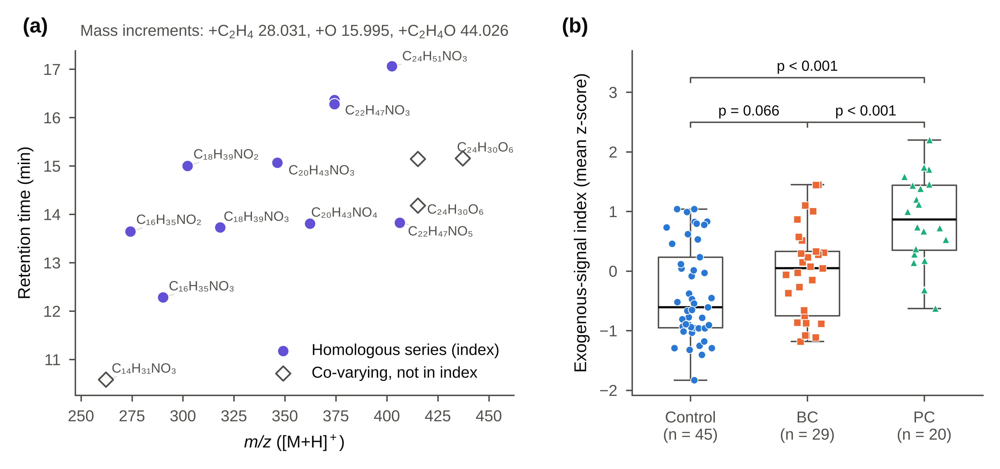{width=16.5cm}

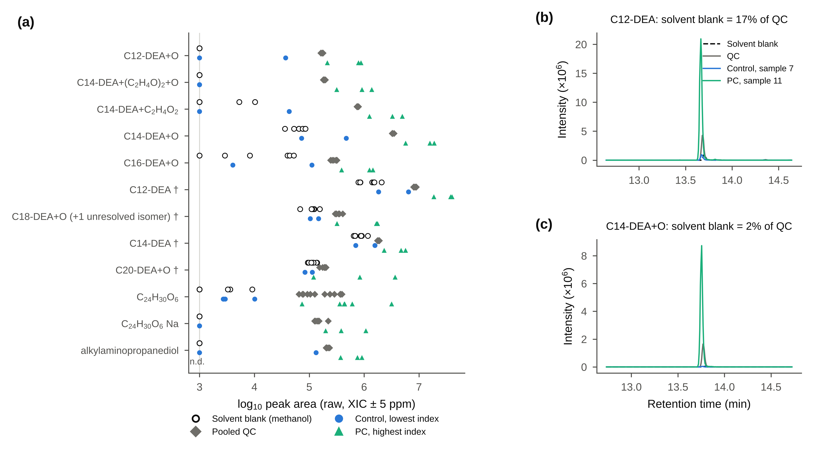{width=16.5cm}

Таблица 1 — Члены гомологического ряда в бланках растворителя (отношение медианной площади в бланках к медиане QC)

| Член ряда | m/z [M+H]⁺ | RT, мин | В индексе | Бланк / QC |
|---|---|---|---|---|
| C12-DEA | 274.2741 | 13.7 | да | 0.167 |
| C12-DEA+O | 290.2690 | 12.3 | да | 0 |
| C14-DEA | 302.3054 | 15 | да | 0.46 |
| C14-DEA+(C₂H₄O)₂+O | 406.3527 | 13.8 | да | 0 |
| C14-DEA+C₂H₄O₂ | 362.3265 | 13.8 | да | 0 |
| C14-DEA+O | 318.3003 | 13.7 | да | 0.02 |
| C16-DEA+O | 346.3316 | 15.1 | да | 0.028 |
| C18-DEA+O (+1 unresolved isomer) | 374.3629 | 16.3 | да | 0.364 |
| C20-DEA+O | 402.3942 | 17.1 | да | 0.611 |
| C₂₄H₃₀O₆ | 415.2115 | 14.2 | нет | 0 |
| C₂₄H₃₀O₆ | 415.2115 | 15.1 | нет | 0 |
| C₂₄H₃₀O₆ Na | 437.1935 | 15.2 | нет | 0 |
| alkylaminopropanediol | 262.2377 | 10.6 | нет | 0 |

## 1.5. Одномерный анализ и правило отбора «находок»

Для каждого соединения строится линейная модель:

log₂(интенсивность) ~ группа + пол + возраст + индекс экзогенного сигнала.

p-значения коэффициента группы корректируются по Бенджамини–Хохбергу (q). Кроме того, выполняются три проверки устойчивости.

1. **Подобранные пары.** Пациенты подбираются 1:1 к участникам группы сравнения оптимальным назначением по возрасту внутри пола: минимум суммарной разницы возрастов, допуск ±5 лет, без возвращения. Пары сравниваются критерием Уилкоксона для связанных выборок по разностям внутри пары. Пары с нулевой разностью (одинаковое импутированное значение у обоих участников) исключаются. Направление изменения определяется по медиане парных разностей.
2. **Сравнение с контролями с низким индексом.** Пациенты сравниваются с контролями, у которых индекс экзогенного сигнала ниже медианы (критерий Манна–Уитни).
3. **Отсутствие зависимости от индекса.** Контроли с высоким и низким индексом не должны различаться по уровню соединения (p ≥ 0.05). Это исключает соединения, уровень которых сам зависит от индекса.

Соединение считается **находкой**, если одновременно выполнены условия:

- q < 0.05 в модели с поправками;
- p < 0.05 в подобранных парах и против контролей с низким индексом, с тем же направлением изменения во всех трёх проверках;
- контроли с высоким и низким индексом не различаются;
- соединение не отнесено к экзогенным.

Для сравнения двух групп пациентов (РМП – РПЖ) условия, связанные с контролями, не применяются.

## 1.6. Классификационные модели без утечки информации

Классификация оценивается стратифицированной пятикратной кросс-валидацией, повторённой 20 раз (100 обучающих фолдов). Сравниваются следующие модели:

- **панель из пяти соединений.** Внутри каждого обучающего фолда отбираются пять соединений с наименьшими p критерия Манна–Уитни, затем строится логистическая регрессия. Отбор повторяется в каждом фолде, тестовая часть в нём не участвует;
- **PLS-DA** с двумя компонентами на всех кандидатах; шкалирование по Парето рассчитывается внутри фолда;
- **панель с поправкой на индекс.** Линейная связь каждого соединения с индексом экзогенного сигнала удаляется внутри фолда (коэффициенты оцениваются только по обучающей части);
- **базовые модели** на одной ковариате (только пол; только индекс) с той же кросс-валидацией. Они показывают, какую часть разделения можно получить без метаболомных данных.

Модели строятся на всех образцах, а также на подмножествах, подобранных по возрасту и полу и по индексу, если пар не меньше десяти. Экзогенные соединения и соединения, коррелирующие с индексом (|ρ| ≥ 0.5), исключаются из пула кандидатов до кросс-валидации. Значимость оценивается перестановочным тестом: 1000 перестановок меток с повторением всей процедуры, включая отбор признаков. AUC приводится как среднее ± SD по повторам.

Панель отбирается заново в каждом фолде, поэтому для оценки её стабильности фиксируются:

- частота, с которой каждое соединение попадает в пятёрку за 100 обучающих фолдов;
- состав панели, отобранной тем же правилом на всех образцах.

## 1.7. Аннотация и уровни достоверности

Уровни достоверности присваиваются по рекомендациям Metabolomics Standards Initiative:

- **уровень 2** — ион-прекурсор в пределах 5 ppm от курированной формулы и совпадение спектра MS/MS с библиотекой;
- **уровень 3** — аннотация, согласующаяся с формулой, без однозначного подтверждения MS/MS (например, совпадение спектра агликона глюкуронида или неразличимые изомеры);
- **уровень 4** — неидентифицированные соединения.

Для каждой курированной аннотации автоматически проверяются три вещи:

- соответствие формулы и типа иона наблюдаемому m/z;
- наличие подтверждающих ионов той же группы;
- альтернативы из HMDB в пределах 3 ppm.

Аннотации с ошибкой массы > 5 ppm выносятся в отдельный список. Библиотечные совпадения, неправдоподобные для мочи человека, переводятся на уровень 4.

## 1.8. Анализы чувствительности и сверка с ранее опубликованными маркерами

Основной анализ повторяется в следующих вариантах:

- с нормализацией MSTUS вместо PQN;
- без образцов с низким коэффициентом разведения;
- с индексом только из членов ряда, отсутствующих в бланках;
- только на соединениях, обнаруженных во всех образцах (без импутации);
- с импутированными значениями, рассматриваемыми как пропуски.

Отдельный модуль сопоставляет ранее заявленные маркеры (по m/z, времени удерживания, иону и формуле) с признаками текущих данных. Для каждого маркера он сообщает:

- согласуются ли формула и m/z;
- категорию происхождения;
- статистику в модели с поправками;
- сохраняется ли направление изменения;
- проходит ли маркер правило находки.

# 2. Апробация на выборке s266 (РМП, РПЖ, контроль)

## 2.1. Выборка и качество данных

После исключения шести образцов с диагнозами вне дизайна исследования (рак почки, n = 3; рак поджелудочной железы, n = 2; множественные первичные опухоли, n = 1) выборка включала 45 контролей, 29 пациентов с РМП и 20 с РПЖ (таблица 2). Возраст и пол известны для всех участников. Группы различались по возрасту и полу:

- контроли моложе обеих групп пациентов;
- мужчины составили 42 % контролей, 83 % пациентов с РМП и 100 % пациентов с РПЖ.

Таблица 2 — Характеристика выборки s266

| Группа | n | Пол, М/Ж (н/д) | Возраст, среднее ± SD | Возраст, медиана (диапазон) | Возраст известен, n |
|---|---|---|---|---|---|
| Контроль | 45 | 19/26 (0) | 53.3 ± 14.6 | 59 (18–72) | 45 |
| РМП | 29 | 24/5 (0) | 62.9 ± 9.7 | 62 (41–78) | 29 |
| РПЖ | 20 | 20/0 (0) | 70.7 ± 6.6 | 70 (62–86) | 20 |

Из 14 693 выровненных признаков 8867 прошли фильтр детекции, а 7403 — фильтр RSD в QC. Медианное RSD составило 8.6 %. Суммарная интенсивность QC оставалась постоянной на протяжении серии, а QC плотно группировались в центре образцов на проекции главных компонент (рисунок 2). Коррекция дрейфа уменьшила бы ошибку предсказания QC лишь с 0.081 до 0.074 единиц log₂ и не применялась. 7403 признака были объединены в 5792 соединения, из которых 718 представлены двумя и более ионами.

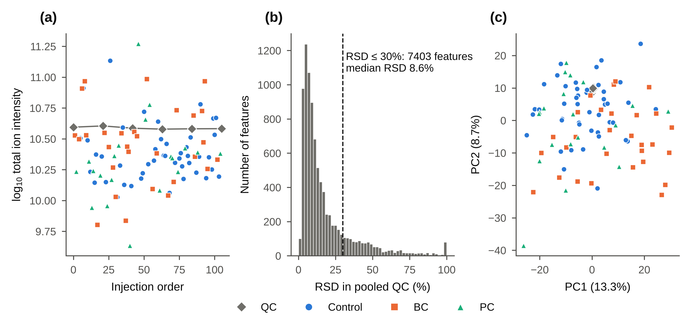{width=16.5cm}

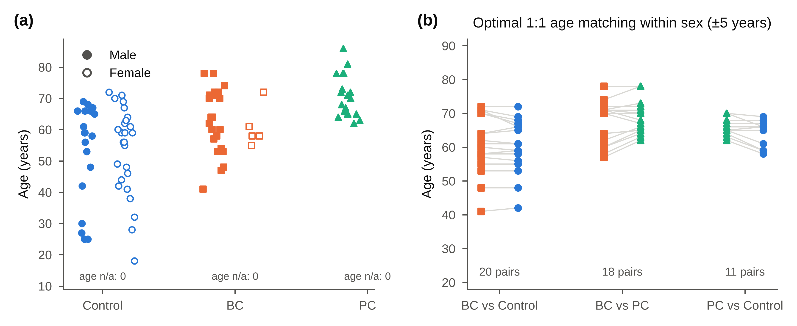{width=16.5cm}

## 2.2. РМП против контроля

В модели с поправками 340 из 5792 соединений имели q < 0.05. Из них 188 прошли все критерии находки: 104 повышены и 84 снижены при РМП (рисунки 6, 7). Пять находок аннотированы на уровнях MSI 2–3, и все они повышены при РМП (таблица 3, рисунок 8). Три из них — конъюгированные стероиды:

- **предполагаемый 11-оксоэтиохоланолон-глюкуронид** ([M+NH₄]⁺ m/z 498.2697, C₂₅H₃₆O₉; сопровождается ионами агликона m/z 287.2007 и 269.1901);
- **два хроматографически разделённых изомера глюкуронида тетрагидрокортизона** (изомер I — 11.06 мин; изомер II — 10.76 мин).

Две другие аннотированные находки — LysoPC(16:0) и биливердин — характерны для плазмы и продуктов распада гема. Возможный вклад гематурии в эти сигналы не может быть исключён: она не регистрировалась.

Таблица 3 — Аннотированные находки РМП – контроль (выборка s266; log₂FC и q — модель с поправками на пол, возраст и индекс экзогенного сигнала; p в парах — критерий Уилкоксона для связанных выборок)

| № | Соединение (уровень MSI) | m/z (ион) | RT, мин | log₂FC | q | AUC | p в парах |
|---|---|---|---|---|---|---|---|
| 1 | 11-Oxoetiocholanolone glucuronide* (3) | 498.2697 [M+NH₄]⁺ | 11.1 | 1.43 | 0.005 | 0.81 | 0.006 |
| 2 | Tetrahydrocortisone glucuronide, isomer I† (3) | 541.2642 [M+H]⁺ | 11.1 | 1.08 | 0.018 | 0.71 | 0.021 |
| 3 | Tetrahydrocortisone glucuronide, isomer II† (3) | 558.2914 [M+NH₄]⁺ | 10.8 | 0.81 | 0.03 | 0.69 | 0.033 |
| 4 | Biliverdin (2) | 583.2553 [M+H]⁺ | 13.5 | 2.23 | 0.024 | 0.77 | 0.033 |
| 5 | LysoPC(16:0) (2) | 496.3397 [M+H]⁺ | 16.7 | 1.33 | 0.025 | 0.79 | 0.007 |

\* 5α-изомер (глюкуронид 11-оксоандростерона) не исключён; аннотация по спектру MS/MS агликона. † Изомеры I и II хроматографически разделены (11.06 и 10.76 мин); алло-тетрагидрокортизон и положение глюкуронида (3 или 21) не установлены.

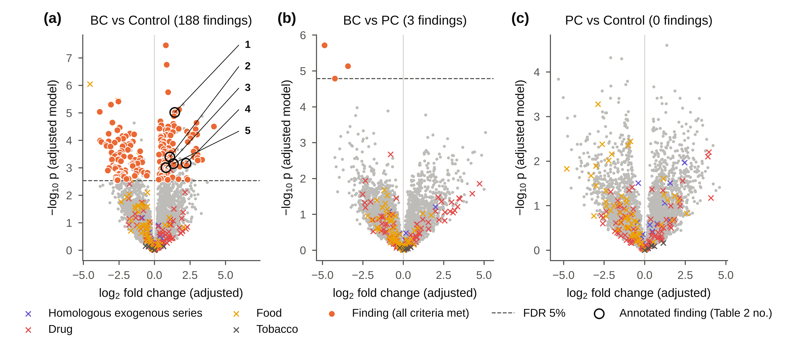{width=16.5cm}

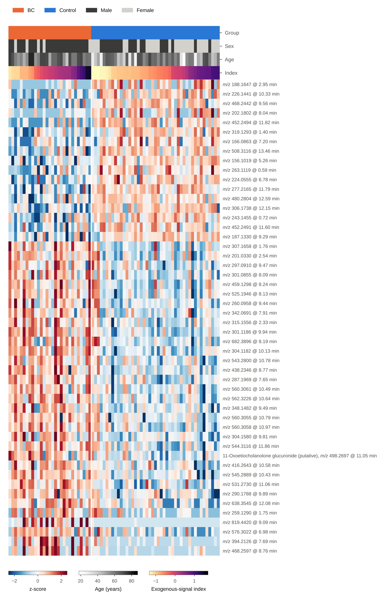{width=12cm}

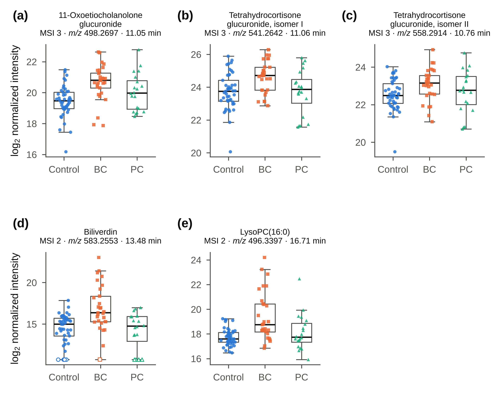{width=16.5cm}

## 2.3. Классификация

Результаты кросс-валидации приведены в таблице 4 и на рисунке 9. Для пары РМП – контроль:

- **на всех образцах:** панель из пяти соединений — AUC 0.81 ± 0.03, PLS-DA — 0.83 ± 0.02;
- **с поправкой на индекс:** 0.78;
- **базовая модель «только пол»:** 0.65;
- **в 20 подобранных парах:** 0.68 (p = 0.10).

Значение на всех образцах следует поэтому рассматривать как верхнюю оценку.

Для РМП – РПЖ поправка на индекс снизила AUC с 0.86 до 0.63 (p = 0.12). Различие двух видов рака, не зависящее от экзогенного сигнала, показать не удалось.

Для РПЖ – контроль выводы такие:

- панель не отделяла группы (AUC 0.54);
- базовая модель «только пол» дала 0.75, потому что все пациенты с РПЖ — мужчины;
- базовая модель «только индекс экзогенного сигнала» дала 0.86.

Иначе говоря, различия между РПЖ и контролем в этой выборке в основном объясняются экзогенным сигналом. Ни одно соединение не прошло критерии находки для РПЖ.

Таблица 4 — Кросс-валидированная классификация (s266; 20×5-кратная CV; p — перестановочный тест, 1000 перестановок)

| Сравнение | Набор проб | Модель | n (случаи/референс) | AUC | p (перестановки) |
|---|---|---|---|---|---|
| РМП – контроль | все пробы | Панель из 5 соединений (отбор внутри фолда) | 29/45 | 0.81 ± 0.03 | 0.001 |
| РМП – контроль | все пробы | Панель, поправка на индекс внутри фолда | 29/45 | 0.78 ± 0.05 | 0.002 |
| РМП – контроль | все пробы | PLS-DA, 2 компоненты | 29/45 | 0.83 ± 0.02 | 0.001 |
| РМП – контроль | все пробы | Только пол (базовая модель) | 29/45 | 0.65 ± 0.02 | 0.002 |
| РМП – контроль | все пробы | Только экзогенный индекс (базовая модель) | 29/45 | 0.59 ± 0.02 | 0.087 |
| РМП – контроль | пары по возрасту и полу | Панель из 5 соединений (отбор внутри фолда) | 20/20 | 0.68 ± 0.05 | 0.100 |
| РМП – контроль | пары по возрасту и полу | Панель, поправка на индекс внутри фолда | 20/20 | 0.55 ± 0.12 | 0.330 |
| РМП – контроль | пары по возрасту и полу | PLS-DA, 2 компоненты | 20/20 | 0.67 ± 0.06 | 0.078 |
| РМП – контроль | пары по возрасту и полу | Только пол (базовая модель) | 20/20 | 0.34 ± 0.05 | 0.848 |
| РМП – контроль | пары по возрасту и полу | Только экзогенный индекс (базовая модель) | 20/20 | 0.74 ± 0.01 | 0.005 |
| РМП – контроль | пары по индексу | Панель из 5 соединений (отбор внутри фолда) | 15/15 | 0.69 ± 0.07 | 0.088 |
| РМП – контроль | пары по индексу | Панель, поправка на индекс внутри фолда | 15/15 | 0.70 ± 0.07 | 0.094 |
| РМП – контроль | пары по индексу | PLS-DA, 2 компоненты | 15/15 | 0.74 ± 0.07 | 0.045 |
| РМП – контроль | пары по индексу | Только пол (базовая модель) | 15/15 | 0.31 ± 0.07 | 0.861 |
| РМП – контроль | пары по индексу | Только экзогенный индекс (базовая модель) | 15/15 | 0.32 ± 0.07 | 0.863 |
| РМП – РПЖ | все пробы | Панель из 5 соединений (отбор внутри фолда) | 29/20 | 0.86 ± 0.04 | 0.002 |
| РМП – РПЖ | все пробы | Панель, поправка на индекс внутри фолда | 29/20 | 0.63 ± 0.07 | 0.122 |
| РМП – РПЖ | все пробы | PLS-DA, 2 компоненты | 29/20 | 0.72 ± 0.03 | 0.011 |
| РМП – РПЖ | все пробы | Только пол (базовая модель) | 29/20 | 0.55 ± 0.01 | 0.062 |
| РМП – РПЖ | все пробы | Только экзогенный индекс (базовая модель) | 29/20 | 0.78 ± 0.01 | 0.001 |
| РМП – РПЖ | пары по возрасту и полу | Панель из 5 соединений (отбор внутри фолда) | 18/18 | 0.78 ± 0.04 | 0.021 |
| РМП – РПЖ | пары по возрасту и полу | Панель, поправка на индекс внутри фолда | 18/18 | 0.62 ± 0.07 | 0.167 |
| РМП – РПЖ | пары по возрасту и полу | PLS-DA, 2 компоненты | 18/18 | 0.71 ± 0.03 | 0.045 |
| РМП – РПЖ | пары по возрасту и полу | Только экзогенный индекс (базовая модель) | 18/18 | 0.76 ± 0.01 | 0.001 |
| РМП – РПЖ | пары по индексу | Панель из 5 соединений (отбор внутри фолда) | 13/13 | 0.57 ± 0.07 | 0.280 |
| РМП – РПЖ | пары по индексу | Панель, поправка на индекс внутри фолда | 13/13 | 0.54 ± 0.08 | 0.357 |
| РМП – РПЖ | пары по индексу | PLS-DA, 2 компоненты | 13/13 | 0.67 ± 0.06 | 0.130 |
| РМП – РПЖ | пары по индексу | Только экзогенный индекс (базовая модель) | 13/13 | 0.28 ± 0.05 | 0.872 |
| РПЖ – контроль | все пробы | Панель из 5 соединений (отбор внутри фолда) | 20/45 | 0.54 ± 0.06 | 0.355 |
| РПЖ – контроль | все пробы | Панель, поправка на индекс внутри фолда | 20/45 | 0.73 ± 0.07 | 0.014 |
| РПЖ – контроль | все пробы | PLS-DA, 2 компоненты | 20/45 | 0.78 ± 0.04 | 0.004 |
| РПЖ – контроль | все пробы | Только пол (базовая модель) | 20/45 | 0.75 ± 0.01 | 0.001 |
| РПЖ – контроль | все пробы | Только экзогенный индекс (базовая модель) | 20/45 | 0.86 ± 0.00 | 0.001 |
| РПЖ – контроль | пары по возрасту и полу | Панель из 5 соединений (отбор внутри фолда) | 11/11 | 0.72 ± 0.12 | 0.083 |
| РПЖ – контроль | пары по возрасту и полу | Панель, поправка на индекс внутри фолда | 11/11 | 0.76 ± 0.10 | 0.054 |
| РПЖ – контроль | пары по возрасту и полу | PLS-DA, 2 компоненты | 11/11 | 0.65 ± 0.07 | 0.163 |
| РПЖ – контроль | пары по возрасту и полу | Только экзогенный индекс (базовая модель) | 11/11 | 0.91 ± 0.01 | 0.001 |
| РПЖ – контроль (мужчины) | все пробы | Панель из 5 соединений (отбор внутри фолда) | 20/19 | 0.63 ± 0.06 | 0.143 |
| РПЖ – контроль (мужчины) | все пробы | Панель, поправка на индекс внутри фолда | 20/19 | 0.65 ± 0.08 | 0.109 |
| РПЖ – контроль (мужчины) | все пробы | PLS-DA, 2 компоненты | 20/19 | 0.79 ± 0.04 | 0.009 |
| РПЖ – контроль (мужчины) | все пробы | Только экзогенный индекс (базовая модель) | 20/19 | 0.93 ± 0.01 | 0.001 |
| РПЖ – контроль (мужчины) | пары по возрасту и полу | Панель из 5 соединений (отбор внутри фолда) | 11/11 | 0.67 ± 0.10 | 0.145 |
| РПЖ – контроль (мужчины) | пары по возрасту и полу | Панель, поправка на индекс внутри фолда | 11/11 | 0.75 ± 0.11 | 0.060 |
| РПЖ – контроль (мужчины) | пары по возрасту и полу | PLS-DA, 2 компоненты | 11/11 | 0.64 ± 0.04 | 0.186 |
| РПЖ – контроль (мужчины) | пары по возрасту и полу | Только экзогенный индекс (базовая модель) | 11/11 | 0.91 ± 0.01 | 0.001 |

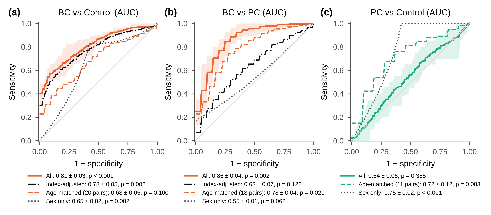{width=16.5cm}

Состав панели РМП – контроль приведён в таблице 5. Ядро панели устойчиво:

- соединения m/z 304.1182 и 301.1186 отобраны в 88 и 72 обучающих фолдах из 100;
- все пять соединений панели, отобранной на всех образцах, являются одномерными находками.

Таблица 5 — Состав панели РМП – контроль (s266): частота отбора соединения в пятёрку за 100 обучающих фолдов

| m/z | RT, мин | Отобрано в фолдах (из 100) | Ранг в панели на всех пробах | Одномерная находка |
|---|---|---|---|---|
| 304.1182 | 10.1 | 88 | 1 | да |
| 301.1186 | 9.94 | 72 | 2 | да |
| 306.1738 | 12.2 | 48 | 4 | да |
| 819.4420 | 9.09 | 47 | 3 | да |
| 438.2351 | 8.99 | 35 | 5 | да |
| 287.1969 | 7.65 | 22 |  | да |
| 531.2730 | 11.1 | 21 |  | да |
| 436.2544 | 12.9 | 21 |  | да |
| 330.1187 | 4.66 | 18 |  | нет |
| 438.2346 | 8.77 | 16 |  | да |
| 277.2165 | 11.8 | 14 |  | да |

## 2.4. Анализы чувствительности

Основные результаты устойчивы к альтернативным решениям при обработке (таблица 6, рисунок 10).

- **Нормализация MSTUS.** Порядок кратностей изменения сохранился (ρ = 1.00).
- **Без самых разведённых образцов.** Сохранились 176 из 188 находок.
- **Индекс только из членов ряда, отсутствующих в бланках.** Сохранились все пять аннотированных находок.
- **Только соединения без импутированных значений.** Все 76 находок из этого набора остались значимыми.

Путей метаболизма со значимым обогащением (FDR < 0.05) не найдено (рисунок 11).

Таблица 6 — Анализы чувствительности (s266)

| Сравнение | Анализ | q < 0.05 | Находки | Общие находки с основным | AUC панели |
|---|---|---|---|---|---|
| РМП – контроль | Основной анализ (PQN, индекс из 10 членов ряда) | 340 | 188 | 188 | 0.81 |
| РМП – контроль | Нормализация MSTUS | 244 | 122 | 109 | 0.80 |
| РМП – контроль | Без проб с PQN-фактором < 0.2 | 536 | 365 | 176 | 0.80 |
| РМП – контроль | Индекс из 5 членов ряда, отсутствующих в бланках | 244 | 165 | 157 | 0.80 |
| РМП – контроль | Только 1366 соединений без импутированных значений | 187 | 90 | 76 |  |
| РМП – контроль | Импутированные значения как пропуски | 339 | 170 | 113 |  |
| РМП – РПЖ | Основной анализ (PQN, индекс из 10 членов ряда) | 3 | 3 | 3 | 0.86 |
| РМП – РПЖ | Нормализация MSTUS | 3 | 3 | 3 | 0.83 |
| РМП – РПЖ | Без проб с PQN-фактором < 0.2 | 10 | 10 | 3 | 0.81 |
| РМП – РПЖ | Индекс из 5 членов ряда, отсутствующих в бланках | 2 | 2 | 2 | 0.65 |
| РМП – РПЖ | Только 1366 соединений без импутированных значений | 0 | 0 | 0 |  |
| РМП – РПЖ | Импутированные значения как пропуски | 0 | 0 | 0 |  |

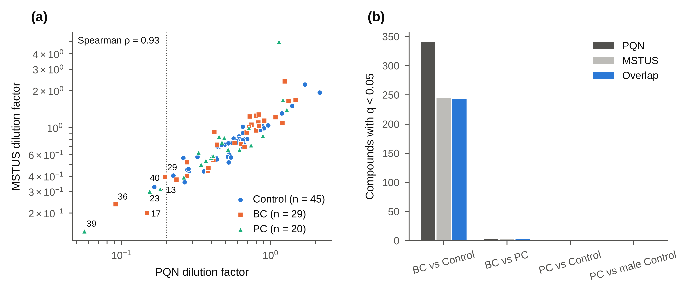{width=16.5cm}

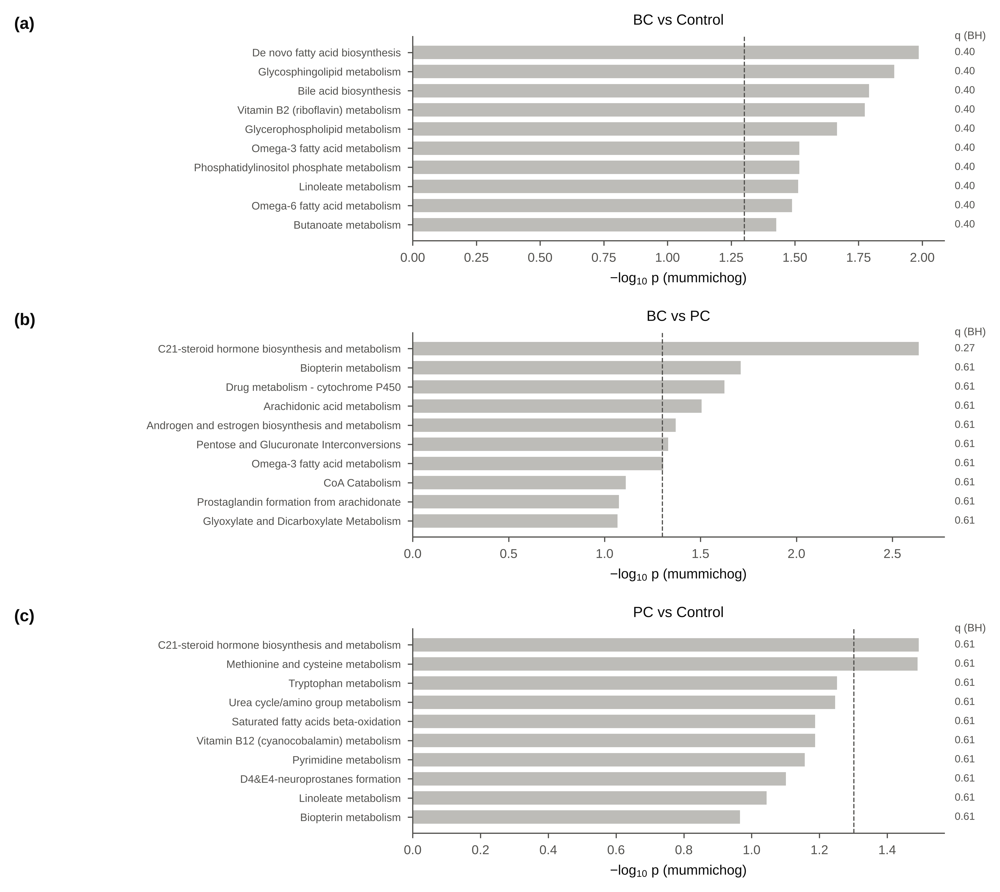{width=16.5cm}

# 3. Апробация на выборке s107 (РМП и контроль)

## 3.1. Выборка и обработка

Таблица MS-DIAL содержала 107 образцов (67 помечены как РМП, 40 контролей) и 21 инъекцию QC. Образцы измерялись в трёх сериях (№ 1–36, 37–72 и 73–107); в каждой серии QC вводился в начале, после каждых шести образцов и в конце (по 7 QC на серию). Бланки растворителя измерялись, но в таблицу не экспортированы; фильтрация по бланкам выполнена в MS-DIAL. Два образца, помеченных как РМП, исключены как не соответствующие дизайну: опухоль мочеточника (№ 54) и гиперплазия гнёзд Брунна без рака (№ 105). Анализировались 65 пациентов с РМП и 40 контролей (таблица 7). Мочу собирали до любых диагностических и хирургических манипуляций; цельную мочу разливали по пробиркам объёмом 4 мл и сразу замораживали при −20 °C; после размораживания каждый образец тщательно перемешивали импульсным встряхиванием. Группы различались по возрасту (p = 0.003) и полу (p = 1.2 × 10⁻⁶): мужчины составили 86 % пациентов и 40 % контролей.

Таблица 7 — Характеристика выборки s107

| Группа | n | Пол, М/Ж | Возраст, среднее ± SD | Возраст, медиана (диапазон) |
|---|---|---|---|---|
| Контроль | 40 | 16/24 | 57.3 ± 14.8 | 60 (18–79) |
| РМП | 65 | 56/9 | 65.4 ± 13.7 | 67 (26–87) |

Обработка была идентичной выборке s266, со следующими адаптациями.

- **Серии измерений.** Группы распределены по сериям сопоставимо (РМП 24/20/21, контроль 12/15/13), однако между сериями обнаружен систематический сдвиг: до коррекции 3483 из 5862 признаков различались в QC разных серий (критерий Краскела–Уоллиса, q < 0.05), медианное RSD в QC составляло 15.6 %. Сдвиг устранён коррекцией по QC: значения каждой серии умножались на отношение медианы всех QC к медиане QC этой серии (для каждого признака отдельно). После коррекции различий QC между сериями не осталось (0 признаков), медианное RSD в QC снизилось до 10.4 % (рисунок 12). Дрейф внутри серий пренебрежимо мал (тест leave-one-QC-out внутри серий: 0.067 без коррекции и 0.065 с LOWESS), коррекция дрейфа не применялась.
- **Экзогенный ряд.** Он найден в тех же ионах, со смещением времени удерживания примерно на −0.42 мин; индекс построен по пяти членам.
- **Деление контролей по индексу.** В отличие от s266, индекс здесь выше у контролей, чем у пациентов (средний z-показатель +0.69 против −0.43). Поэтому контроли делились на «низкий» и «высокий» индекс по медиане контролей (20/20), а не по общей медиане (8/32).

Из 12 930 признаков 5862 прошли фильтр детекции, а 4713 (после коррекции межсерийного сдвига) — фильтр RSD (медиана 8.0 %). Они были объединены в 3595 соединений (480 многоионных), импутировано 10.8 % значений.

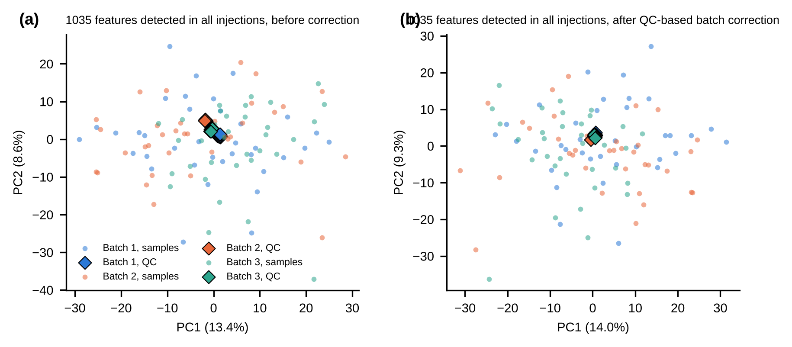{width=16.5cm}

## 3.2. Результаты

В модели с поправками 927 соединений имели q < 0.05. Из них 584 прошли все критерии находки: 287 повышены и 297 снижены при РМП (рисунок 14). Разделение групп оказалось почти полным (таблица 8):

- панель из пяти соединений — AUC 0.99, PLS-DA — 1.00;
- разделение сохранялось в 24 парах, подобранных по возрасту и полу (0.99), и в парах, подобранных по индексу (1.00);
- на 690 кандидатах, обнаруженных во всех образцах, AUC панели составил 0.98, PLS-DA — 0.99, то есть разделение не объясняется импутацией.

На проекции главных компонент по соединениям, обнаруженным во всех образцах, первая компонента разделяла группы (AUC 0.73) и не была связана с порядком инъекций (ρ = −0.19; рисунок 13).

Таблица 8 — Кросс-валидированная классификация (s107)

| Набор проб | Модель | n (РМП/контроль) | AUC | p (перестановки) |
|---|---|---|---|---|
| все пробы | Панель из 5 соединений (отбор внутри фолда) | 65/40 | 0.990 ± 0.006 | < 0.001 |
| все пробы | Панель, поправка на индекс внутри фолда | 65/40 | 0.882 ± 0.017 | < 0.001 |
| все пробы | PLS-DA, 2 компоненты | 65/40 | 1.000 ± 0.000 | < 0.001 |
| все пробы | Только пол (базовая модель) | 65/40 | 0.681 ± 0.014 | < 0.001 |
| все пробы | Только экзогенный индекс (базовая модель) | 65/40 | 0.807 ± 0.007 | < 0.001 |
| пары по возрасту и полу | Панель из 5 соединений (отбор внутри фолда) | 24/24 | 0.990 ± 0.008 | < 0.001 |
| пары по возрасту и полу | Панель, поправка на индекс внутри фолда | 24/24 | 0.920 ± 0.024 | < 0.001 |
| пары по возрасту и полу | PLS-DA, 2 компоненты | 24/24 | 0.999 ± 0.001 | < 0.001 |
| пары по возрасту и полу | Только пол (базовая модель) | 24/24 | 0.354 ± 0.045 | 0.829 |
| пары по возрасту и полу | Только экзогенный индекс (базовая модель) | 24/24 | 0.642 ± 0.015 | 0.037 |
| пары по индексу | Панель из 5 соединений (отбор внутри фолда) | 19/19 | 1.000 ± 0.000 | < 0.001 |
| пары по индексу | Панель, поправка на индекс внутри фолда | 19/19 | 1.000 ± 0.001 | < 0.001 |
| пары по индексу | PLS-DA, 2 компоненты | 19/19 | 1.000 ± 0.000 | < 0.001 |
| пары по индексу | Только пол (базовая модель) | 19/19 | 0.327 ± 0.053 | 0.856 |
| пары по индексу | Только экзогенный индекс (базовая модель) | 19/19 | 0.335 ± 0.053 | 0.861 |

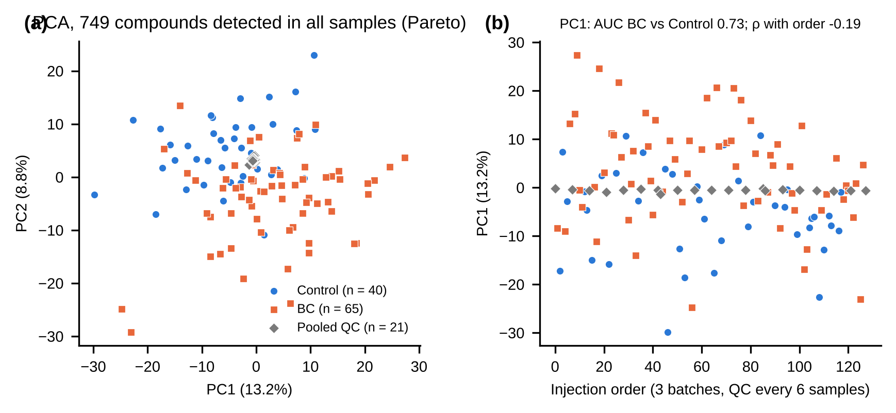{width=16.5cm}

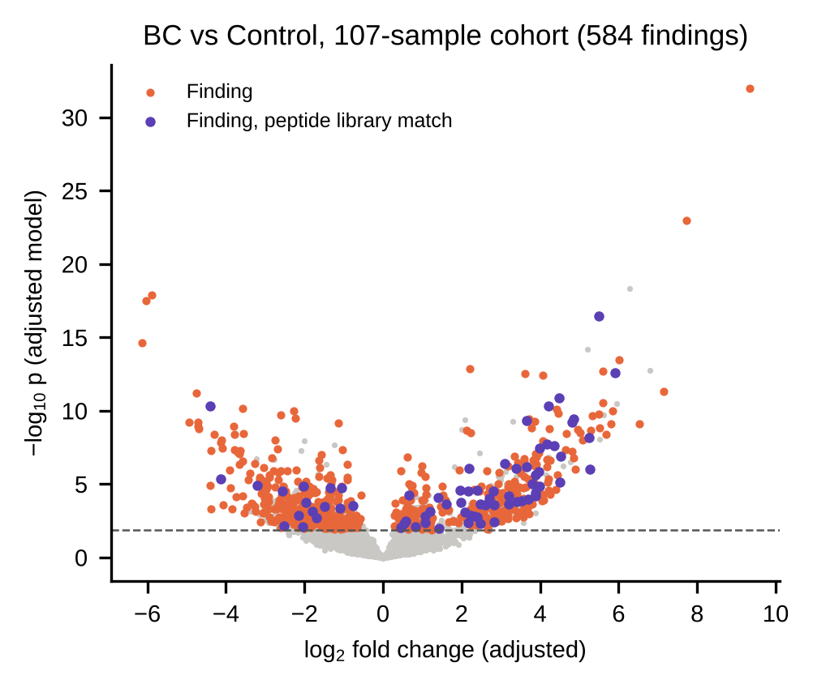{width=16.5cm}

Среди соединений, повышенных при РМП, преобладали короткие пептиды (рисунок 15):

- библиотечные совпадения с ди- и трипептидами встречались среди них в 3.2 раза чаще, чем среди остальных соединений (78 из 458 против 200 из 3137; точный тест Фишера p = 8 × 10⁻¹³);
- наиболее сильные сигналы — Val-Leu (log₂FC 3.3, AUC 0.98) и m/z 244.1293 (log₂FC 9.3, AUC 0.98; обнаружен у 98 % пациентов и 32 % контролей). Val-Leu не прошёл критерий независимости от индекса (контроли с высоким и низким индексом различались, p = 0.027) и формально не является находкой.

Последний сигнал в отчёте первого этапа обозначен как N-мевалонилкреатинин. Его брутто-формула C₁₀H₁₇N₃O₄ совпадает с формулой дипептида Gln-Pro — альтернативной аннотации того же признака.

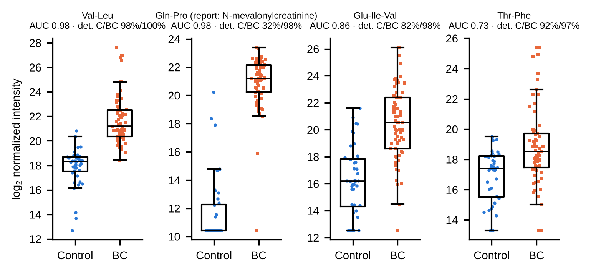{width=16.5cm}

Почти полное разделение, обусловленное в основном пептидами, практически отсутствующими в моче контролей, нельзя считать оценкой диагностической точности. Мочу собирали до диагностических и хирургических манипуляций, поэтому влияние цистоскопии, катетеризации и периоперационной терапии исключено. Тем не менее такой профиль согласуется скорее с примесью крови или белка в моче пациентов, чем с метаболизмом опухоли. Гематурия — основной симптом РМП, и гемоглобин и белки плазмы служат субстратом протеолиза. Хранение при −20 °C (а не при −80 °C) не исключает частичного протеолиза в замороженных образцах, а различия в длительности хранения между группами неизвестны. На внеаналитический характер части различий указывает и индекс экзогенного сигнала, который в этой выборке выше у контролей. Гематурия и протеинурия не регистрировались, поэтому разделить эти объяснения невозможно.

Из путей метаболизма на границе значимости оказался только метаболизм лейкотриенов (mummichog, q = 0.046); результат mummichog зависит от случайных перестановок (в прогоне до коррекции серий q = 0.068), поэтому он не интерпретируется.

## 3.3. Воспроизведение находок выборки s266

Все три стероидных глюкуронида, найденные в выборке s266, повышены при РМП и в выборке s107 и проходят в ней все критерии находки (таблица 9, рисунок 16). Каждое соединение найдено в виде той же группы ионов со смещением времени удерживания −0.30…−0.33 мин.

Биливердин не воспроизвёлся. LysoPC(16:0) в выборке s107 не прошёл фильтры.

Таким образом, повышение конъюгированных андрогенов и глюкокортикоидов — единственный аннотированный результат по РМП, независимо наблюдаемый в двух выборках, с близкими величинами эффекта (AUC 0.69–0.81 в s266 и 0.71–0.75 в s107).

Таблица 9 — Находки выборки s266 (таблица 3) в выборке s107

| Соединение | m/z | log₂FC (s266) | q (s266) | log₂FC (s107) | q (s107) | AUC (s107) | p в парах (s107) | Находка в s107 |
|---|---|---|---|---|---|---|---|---|
| 11-Oxoetiocholanolone glucuronide | 498.2697 | 1.43 | 0.005 | 0.83 | 0.005 | 0.74 | 0.015 | да |
| Tetrahydrocortisone glucuronide, isomer I | 541.2642 | 1.08 | 0.018 | 0.87 | 0.008 | 0.75 | 0.029 | да |
| Tetrahydrocortisone glucuronide, isomer II | 558.2914 | 0.81 | 0.030 | 0.54 | 0.022 | 0.71 | 0.012 | да |
| Biliverdin | 583.2553 | 2.23 | 0.024 | -0.83 | 0.376 | 0.51 | 0.259 | нет |
| LysoPC(16:0) | 496.3397 | 1.33 | 0.025 |  |  |  |  |  |

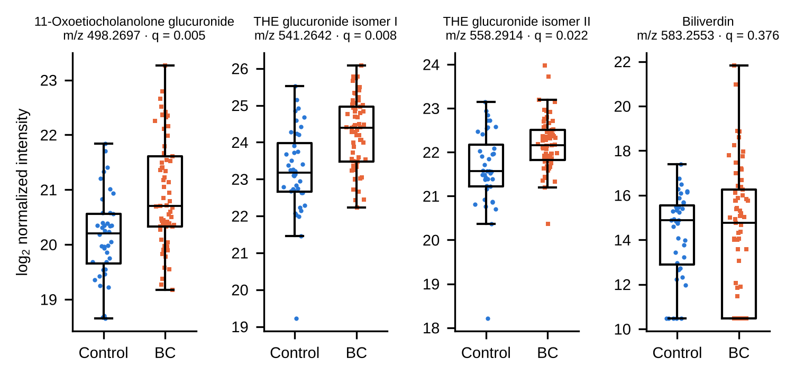{width=16.5cm}

# 4. Проверка маркеров, предложенных в предыдущих обработках

## 4.1. Тридцать маркеров РМП первого этапа

Маркеры из таблицы 20 отчёта первого этапа (они же — маркеры статьи ABC) были сопоставлены с признаками выборки s107 и оценены тем же фреймворком (таблица 10). Все 30 сигналов найдены в данных. У 28 направление изменения в модели с поправками совпадает с заявленным. Вместе с тем:

- **Экзогенные соединения.** 17 из 30 маркеров относятся к экзогенным: шесть лекарств и их метаболитов (ацетилцистеин, венлафаксин, самурациклиб, глюкуронид антипирина, метаболит карфилзомиба, аддукт пропофола с N-ацетилцистеином), алкалоид табака 5-метилмиосмин и десять соединений пищевого и растительного происхождения. Их уровень отражает сопутствующую лекарственную терапию и питание, которые систематически различаются у пациентов и добровольцев (пробы собраны до диагностических и хирургических манипуляций, то есть это не следствие периоперационной терапии). Поэтому как маркеры РМП они рассматриваться не могут.
- **Подтверждённые находки.** Из остальных 13 маркеров восемь прошли все критерии находки: пептиды (m/z 244.129, Thr-Phe, Asn-Phe, Glu-Ile-Val), два глюкуронида оксилипинов (m/z 508.312), глюкуронид γ-CEHC и сигнал m/z 445.243.
- **Идентификации требуют пересмотра.**
  - Грейанотоксин I не соответствует m/z 445.243 (расхождение > 77 000 ppm).
  - У 5-метилмиосмина расхождение 63 ppm.
  - Брутто-формула пептида EFTPAVAH даёт [M+2H]²⁺ m/z 436.218, а не 436.254.
  - m/z 244.129, вероятнее, — дипептид Gln-Pro.

Таблица 10 — Маркеры первого этапа (таблица 20 отчёта) в выборке s107

| № | Соединение (отчёт) | Заявлено | m/z | Формула vs m/z, ppm | Категория | log₂FC | q | AUC | Находка |
|---|---|---|---|---|---|---|---|---|---|
| 1 | Nepetazide | ↓ | 347.1704 | 1.0 | пища | -0.97 | 0.043 | 0.22 | нет |
| 2 | 5-Methylmyosmine | ↓ | 161.1174 | 62.5 | табак | -2.05 | < 0.001 | 0.31 | нет |
| 3 | Acetylcysteine | ↓ | 164.0376 | 0.1 | лекарство | -2.21 | 0.004 | 0.27 | нет |
| 4 | 4-hydroxy-3-(2-hydroxyethyl)acetophenone | ↓ | 181.0862 | 1.5 | пища | -1.39 | 0.014 | 0.25 | нет |
| 5 | Isoferulic acid | ↓ | 195.0653 | 0.6 | пища | -1.47 | 0.029 | 0.3 | нет |
| 6 | Kmeriol | ↓ | 243.1228 | 0.4 | пища | -0.87 | 0.003 | 0.32 | нет |
| 7 | N-Mevalonylcreatinine | ↑ | 244.1293 | 0.5 | эндогенное | 9.33 | < 0.001 | 0.98 | да |
| 8 | N-acetyl-S-(N-allylthiocarbamoyl)cysteine | ↓ | 263.0520 | 0.5 | пища | -3.03 | 0.008 | 0.33 | нет |
| 9 | Threonyl-phenylalanine (Thr-Phe) | ↑ | 267.1337 | -0.9 | эндогенное | 2.09 | 0.006 | 0.73 | да |
| 10 | 3,6-bis(2-(methylthio)ethyl)-1,4-dioxane-2,5-diol | ↑ | 269.0880 | 1.6 | пища | 2.08 | < 0.001 | 0.92 | нет |
| 11 | D-cyclohexanone glycoside | ↓ | 278.1602 | 1.4 | пища | -0.87 | 0.003 | 0.32 | нет |
| 12 | Venlafaxine | ↑ | 278.2121 | 2.3 | лекарство | 2.07 | 0.065 | 0.67 | нет |
| 13 | Asparaginyl-phenylalanine (Asn-Phe) | ↑ | 280.1294 | 0.8 | эндогенное | 2.61 | 0.003 | 0.76 | да |
| 14 | 3-Hydroxyoctanoylcarnitine | ↑ | 304.2118 | -0.2 | эндогенное | 0.64 | 0.328 | 0.7 | нет |
| 15 | 4-Methylcinnamylcarnitine | ↓ | 306.1704 | 1.4 | эндогенное | -0.96 | 0.089 | 0.28 | нет |
| 16 | (2S)-2-((2-morpholinoacetyl)amino)-4-phenylbutanoic acid | ↑ | 307.1661 | 2.8 | лекарство | 1.11 | 0.126 | 0.73 | нет |
| 17 | N, N-Dimethylsphingosine | ↓ | 330.3373 | 2.0 | эндогенное | 0.57 | 0.035 | 0.33 | нет |
| 18 | Glutamyl-isoleucyl-valine (Glu-Ile-Val) | ↑ | 360.2129 | 0.0 | эндогенное | 3.66 | < 0.001 | 0.86 | да |
| 19 | D-Vanillyl glycol glycoside | ↓ | 378.1763 | 1.2 | пища | -2.3 | 0.010 | 0.19 | нет |
| 20 | Fraxin | ↓ | 388.1242 | 1.0 | пища | -1.47 | 0.029 | 0.3 | нет |
| 21 | D-glucuronide of perillyl glycolic acid | ↓ | 394.1710 | 0.6 | пища | -1.36 | 0.033 | 0.25 | нет |
| 22 | Samuraciclib | ↓ | 395.2541 | -3.3 | лекарство | -2.78 | < 0.001 | 0.17 | нет |
| 23 | D-glucuronide of 3-(hydroxymethyl)antipyrine | ↑ | 381.1288 | -1.2 | лекарство | -0.89 | 0.602 | 0.54 | нет |
| 24 | Peptide EFTPAVAH | ↑ | 436.2535 | — | не установлено | 2.36 | 0.028 | 0.7 | нет |
| 25 | Grayanotoxin I | ↓ | 445.2431 | 77409.5 | не установлено | -1.89 | < 0.001 | 0.23 | да |
| 26 | 9-β-D-glucuronide of 12Z-9, 10-dihydroxyoctadecenoic acid | ↓ | 508.3119 | 0.6 | эндогенное | -3.63 | < 0.001 | 0.18 | да |
| 27 | D-glucuronide of γ-CEHC | ↓ | 458.2026 | 1.2 | эндогенное | -1.29 | 0.016 | 0.23 | да |
| 28 | 12-D-glucuronide of 9Z-12, 13-dihydroxyoctadecenoic acid | ↓ | 508.3119 | 0.6 | эндогенное | -3.63 | < 0.001 | 0.18 | да |
| 29 | Taurinyl-(9Z)-3-hydroxydodecenoylcarnitine | ↑ | 481.2582 | 0.8 | эндогенное | 1.15 | 0.069 | 0.72 | нет |
| 30 | N-acetylcysteinyl-2, 6-diisopropylphenol | ↓ | 485.2682 | 0.4 | лекарство | -3.23 | < 0.001 | 0.15 | нет |

## 4.2. Маркеры РПЖ предыдущей обработки выборки s266

25 сигналов, предложенных в предыдущей обработке как маркеры РПЖ (таблицы 22, 28 и 29 отчёта), были сопоставлены с признаками выборки s266 (±10 ppm, ±0.2 мин). Для каждого получена его статистика в настоящей обработке (таблица 11). Все 25 сигналов найдены.

- **14 сигналов (№ 11–24) — члены гомологического экзогенного ряда**, по которому строится индекс экзогенного сигнала. В отчёте часть из них аннотирована как фитосфингозин, аминоспирты, 15(S)-ГЭТЭ, 2(R)-гидроксиэйкозановая кислота, армилларин, нирантин и эплеренон.
  - Фитосфингозин (C₁₈H₃₉NO₃) изобарен C₁₄-диэтаноламину с одним атомом кислорода и элюируется в его времени удерживания внутри ряда.
  - 15(S)-ГЭТЭ (C₂₀H₃₂O₃, [M+H]⁺ 321.242) и 2-гидроксиэйкозановая кислота (C₂₀H₄₀O₃, [M+H]⁺ 329.305) не соответствуют наблюдаемым m/z 302.306 и 346.332. Это C₁₄-диэтаноламин и окисленный C₁₆-диэтаноламин.
  - Эти сигналы сильно коррелируют с индексом (ρ = 0.83–0.98). Повышены при РПЖ они потому, что сам индекс выше в образцах РПЖ. После поправки на индекс ни один не значим (q ≥ 0.26).
- **Сигнал № 25** (m/z 531.275) также коррелирует с индексом (ρ = 0.84) и не значим после поправки (q = 0.49).
- **Сигналы № 1–10** номинально значимы в критерии Манна–Уитни без поправок, но ни один не проходит контроль FDR (q = 0.06–0.26). В модели с поправками q ≥ 0.13, в сравнении с мужчинами-контролями q ≥ 0.61.
  - Для кинуреновой кислоты, Pro-Asp, Pro-Tyr и m/z 345.155 в таблице 22 отчёта указано повышение при РПЖ, тогда как в данных они снижены (log₂FC от −1.0 до −3.8). Снижение согласуется с отрицательными logFC в таблице 29 того же отчёта.
  - Брутто-формулы ряда аннотаций не дают наблюдаемых m/z. Pro-Asp: [M+H]⁺ 231.098 против 211.072. Pro-Tyr: 279.134 против 261.124 (возможен лишь ион с потерей воды). Аденозин: [M+H]⁺ 268.104; [M+Na]⁺ 290.086 — на 35 ppm от 290.096.

Таблица 11 — Маркеры РПЖ предыдущей обработки в настоящей обработке выборки s266

| № | RT | m/z | Аннотация (отчёт) | Член экзогенного ряда | ρ с индексом | log₂FC (без поправок) | q (без поправок) | q (модель с поправками) | q (мужчины-контроли) |
|---|---|---|---|---|---|---|---|---|---|
| 1 | 1.6 | 190.050 | Kynurenic acid | — |  | -1.02 | 0.257 | 0.91 | 0.89 |
| 2 | 2 | 211.072 | Pro-Asp | — | -0.23 | -2.1 | 0.085 | 0.43 | 0.92 |
| 3 | 3.6 | 261.124 | Pro-Tyr | — | -0.33 | -2.97 | 0.099 | 0.54 | 0.92 |
| 4 | 7.9 | 345.155 | Anethole glycol 1-glucoside | — | -0.14 | -3.76 | 0.094 | 0.13 | 0.61 |
| 5 | 8.3 | 174.055 | Quinoline-2-carboxylic acid | — | 0.26 | 2.15 | 0.129 | 0.39 | 0.75 |
| 6 | 8.8 | 290.096 | Adenosine | — | -0.41 | -2.61 | 0.063 | 0.79 | 0.93 |
| 7 | 10 | 715.315 |  | — |  | -0.94 | 0.172 | 0.21 | 0.75 |
| 8 | 10 | 746.245 |  | — |  | -0.94 | 0.172 | 0.21 | 0.75 |
| 9 | 10 | 385.126 | (indole lactam) | — |  | -0.94 | 0.172 | 0.21 | 0.75 |
| 10 | 10.1 | 350.160 | Erucifoline | — | -0.21 | -2.96 | 0.094 | 0.70 | 1.00 |
| 11 | 10.6 | 262.238 |  | alkylaminopropanediol | 0.87 | 3.21 | 0.016 | 0.69 | 0.65 |
| 12 | 12.3 | 290.269 |  | C12-DEA+O | 0.94 | 3.6 | 0.011 | 0.77 | 0.96 |
| 13 | 13.6 | 274.274 |  | C12-DEA | 0.93 | 2.14 | 0.025 | 0.83 | 0.96 |
| 14 | 13.7 | 318.300 | Phytosphingosine | C14-DEA+O | 0.98 | 3.69 | 0.004 | 0.70 | 0.78 |
| 15 | 13.8 | 362.327 | 2-Amino-1,3,4,5-eicosanetetrol | C14-DEA+C2H4O2 | 0.92 | 4.76 | 0.004 | 0.52 | 0.61 |
| 16 | 13.8 | 406.353 | 2-Amino-12,16-dimethyleicosane-pentol | C14-DEA+(C2H4O)2+O | 0.91 | 5.65 | 0.009 | 0.37 | 0.61 |
| 17 | 14.2 | 415.212 | Armillarin / Nirantin | C24H30O6 | 0.83 | 5.54 | 0.001 | 0.26 | 0.62 |
| 18 | 15 | 302.306 | 15(S)-HETE | C14-DEA | 0.92 | 1.37 | 0.017 | 0.37 | 0.68 |
| 19 | 15.1 | 346.332 | 2(R)-Hydroxyeicosanoic acid | C16-DEA+O | 0.94 | 2.79 | 0.002 | 0.92 | 0.70 |
| 20 | 15.1 | 415.212 | Armillarin / Nirantin | C24H30O6 | 0.86 | 6.54 | 0.027 | 0.66 | 0.87 |
| 21 | 15.2 | 437.194 | Eplerenone | C24H30O6 Na |  | 6.54 | 0.027 | 0.66 | 0.87 |
| 22 | 16.3 | 374.363 |  | C18-DEA+O | 0.95 | 1.97 | 0.002 | 0.81 | 0.76 |
| 23 | 16.4 | 374.363 |  | C18-DEA+O isomer | 0.86 | 1.86 | 0.015 | 0.68 | 0.83 |
| 24 | 17.1 | 402.394 |  | C20-DEA+O | 0.84 | 1.67 | 0.002 | 0.96 | 0.78 |
| 25 | 18.1 | 531.275 |  | — | 0.84 | 3.65 | 0.001 | 0.49 | 0.83 |

Ни один из 25 сигналов не выдерживает учёта пола, возраста и индекса экзогенного сигнала вместе с контролем FDR. Более половины из них — сам экзогенный ряд. Это согласуется с результатом настоящей обработки, в которой ни одно соединение не прошло критерии находки для РПЖ – контроль. Кажущиеся маркеры РПЖ объясняются тремя причинами:

- более высоким индексом экзогенного сигнала в образцах РПЖ, то есть внеаналитическим фактором, связанным с контейнерами или условиями сбора;
- ошибками аннотации;
- отсутствием поправки на множественные сравнения.

# 5. Обсуждение

Разработанный фреймворк изменяет постановку задачи поиска биомаркеров. Вопрос «какие сигналы различаются между группами» заменяется вопросом «какие различия сохраняются после исключения известных систематических источников».

Сравнение с предыдущими обработками тех же данных показывает практическое значение каждого компонента.

- **Учёт экзогенного происхождения сигналов.** Он исключил из числа маркеров РМП 17 из 30 ранее предложенных соединений, а из числа маркеров РПЖ — 15 из 25 сигналов (14 членов ряда и один сигнал, сильно коррелирующий с индексом).
- **Ковариаты, подобранные пары и контроль FDR.** Вместе они не позволили принять за маркеры РПЖ номинально значимые различия.
- **Объединение ионов в соединения и контроль формул и ионов.** Они выявили ошибочные аннотации: изобарные члены ряда, неверные типы ионов, формулы, не соответствующие m/z.
- **Вложенный отбор признаков и перестановочные тесты.** Они дают несмещённую оценку точности классификаторов. Сравнение с базовыми моделями и с моделями на подобранных подмножествах показывает, какая часть разделения обусловлена полом, возрастом и экзогенным сигналом.

Фреймворк не устраняет ограничений, заложенных в дизайне выборок. Это иллюстрирует выборка s107: разделение групп сохраняется во всех проверках, но его масштаб и пептидный состав указывают на внеаналитические различия между группами. Распознать такую ситуацию позволяют базовые модели, анализ состава сигнала и сравнение с независимой выборкой. Устранить её можно только изменением дизайна:

- согласованием групп по полу и возрасту;
- единым протоколом сбора и хранения проб для пациентов и контролей (включая хранение при −80 °C и учёт длительности хранения);
- регистрацией гематурии, протеинурии, лекарственной терапии, курения и питания.

Результат, независимо воспроизведённый в двух выборках, — повышение глюкуронидов 11-оксоэтиохоланолона и тетрагидрокортизона при РМП. Он нуждается в подтверждении стандартами (уровень MSI 1) и в проверке на выборке, сбалансированной по полу и возрасту. Повышение экскреции глюкокортикоидов может отражать и общую реакцию организма на заболевание.

# Выводы

1. Разработан и программно реализован фреймворк обработки данных ВЭЖХ-МСВР профилирования мочи. Он включает:
   - предобработку с контролем качества по QC, включая коррекцию межсерийного сдвига;
   - объединение ионов в соединения;
   - оценку экзогенного происхождения сигналов с построением индекса экзогенного сигнала;
   - одномерный анализ с поправками на пол, возраст и индекс, подобранными парами и контролем FDR;
   - классификационные модели с отбором признаков внутри кросс-валидации, перестановочными тестами и базовыми моделями;
   - контроль аннотаций и анализы чувствительности.

   Обработка полностью воспроизводима и управляется единым конфигурационным файлом.
2. На выборке s266 (94 образца) найдено 188 соединений, различающихся при РМП и контроле с учётом всех критериев. Пять из них аннотированы (MSI 2–3). Кросс-валидированная AUC панели РМП – контроль составила 0.81, в подобранных парах — 0.68. Соединений, специфичных для РПЖ, не найдено.
3. На независимой выборке s107 (105 образцов) воспроизведено повышение трёх стероидных глюкуронидов при РМП. Почти полное разделение групп в этой выборке связано с пептидным сигналом и, вероятно, с внеаналитическими различиями. Как оценку диагностической точности его рассматривать нельзя.
4. Из 30 маркеров РМП первого этапа 17 являются экзогенными, а восемь из остальных 13 подтверждены как находки; ряд идентификаций требует пересмотра. Из 25 маркеров РПЖ предыдущей обработки ни один не выдерживает поправок на пол, возраст, индекс экзогенного сигнала и множественные сравнения. 14 из 25 являются членами экзогенного гомологического ряда.

# Приложение А. Основные параметры фреймворка

| Параметр | Значение |
|---|---|
| Детекция в QC | ≥ 80 % инъекций |
| Детекция в группе | ≥ 50 % образцов хотя бы одной группы |
| RSD в QC | ≤ 30 % |
| Серии измерений | коррекция межсерийного сдвига по медианам QC серии (s107: 3 серии) |
| Коррекция дрейфа | по результату теста leave-one-QC-out внутри серий (не применялась) |
| Нормализация | PQN, опорный спектр — медиана QC; MSTUS — анализ чувствительности |
| Импутация | ½ минимума признака; затем log₂ |
| Объединение ионов | ΔRT ≤ 0.02 мин, ρ Спирмена ≥ 0.8; допуск массы 5 ppm |
| Модель | log₂ ~ группа + пол + возраст + индекс экзогенного сигнала; FDR (Бенджамини–Хохберг) |
| Подобранные пары | оптимальное назначение по возрасту внутри пола, допуск ±5 лет, критерий Уилкоксона для связанных выборок |
| Контроли по индексу | деление по медиане (s266 — всех образцов; s107 — контролей); критерий Манна–Уитни |
| Правило находки | q < 0.05; p < 0.05 в парах и против контролей с низким индексом, одно направление; контроли high/low p ≥ 0.05; не экзогенное |
| Кросс-валидация | стратифицированная 5-кратная × 20 повторов; панель из 5 соединений (отбор внутри фолда), PLS-DA (2 компоненты) |
| Пул кандидатов | без экзогенных соединений и соединений с |ρ| ≥ 0.5 с индексом |
| Перестановочный тест | 1000 перестановок со всей процедурой отбора |
| Пути метаболизма | mummichog 2.7.0, верхние 10 % по p, 500 перестановок |

# Приложение Б. Структура программного кода

| Файл / модуль | Назначение |
|---|---|
| `pipeline/config.py` | все параметры обработки; переключение набора данных (`METAB_DATASET=s107`) |
| `pipeline/io.py` | чтение таблицы MS-DIAL и метаданных, порядок инъекций |
| `pipeline/preprocess.py` | фильтры, тест дрейфа, PQN/MSTUS, импутация и log₂ |
| `pipeline/features.py` | объединение ионов в соединения, категории происхождения, гомологический ряд и индекс экзогенного сигнала |
| `pipeline/stats.py` | подбор пар, модель с ковариатами, критерий Уилкоксона, правило находки |
| `pipeline/multivariate.py` | кросс-валидация без утечки, перестановочные тесты, состав панели |
| `pipeline/annotate.py` | курация аннотаций, проверка формул и ионов, уровни MSI |
| `pipeline/replication.py` | сверка с ранее заявленными маркерами |
| `pipeline/pathways.py` | анализ путей (mummichog) |
| `run_all.py` | полный запуск обработки |
| `make_figures.py` | рисунки и таблицы для публикации (s266) |
| `report_s107.py` | рисунки и таблицы для выборки s107 |
| `blank_check.py` | проверка членов ряда в бланках по исходным mzML |
| `sensitivity_index.py`, `sensitivity_imputation.py` | анализы чувствительности |
| `curation/`, `curation_s107/` | курированные аннотации, экзогенный ряд, ключевые слова, ранее заявленные маркеры |
| `report_chapter_ru/build_chapter.py` | сборка настоящей главы |

Команды запуска:

```
pip install -r requirements.txt
python run_all.py                          # выборка s266 -> results/
python blank_check.py                      # проверка бланков (нужны mzML)
python sensitivity_index.py; python sensitivity_imputation.py
python make_figures.py --variant v5        # рисунки и таблицы статьи
METAB_DATASET=s107 python run_all.py       # выборка s107 -> results_s107/
python report_s107.py                      # рисунки и таблицы s107
python report_chapter_ru/build_chapter.py  # настоящая глава
```

# Приложение В. Таблицы результатов

Полные таблицы приведены в файлах:

- **`appendix/Прил_В1_таблицы_s266.xlsx`:**
  - S1 — все находки РМП;
  - S2 и S2b — классификация и состав панелей;
  - S3 — курированные аннотации;
  - S4 — признаки «есть/нет»;
  - S5 — статистика по всем соединениям;
  - S6 — анализы чувствительности;
  - S7 — проверка бланков;
  - S8 — список ключевых слов.
- **`appendix/Прил_В2_основные_таблицы_s266.xlsx`:** таблицы 2 и 3 настоящей главы в полном виде.
- **`appendix/Прил_В3_таблицы_s107_и_проверка_маркеров.xlsx`:**
  - маркеры первого этапа в s107;
  - воспроизведение находок s266;
  - маркеры РПЖ предыдущей обработки;
  - все находки и классификация s107.

# Приложение Г. Программный код

Полный исходный код фреймворка с курационными файлами и метаданными приведён в архиве `appendix/Прил_Г_код_фреймворка.zip`. Ниже — ключевые фрагменты.

**Правило отбора находок** (`pipeline/stats.py`):

```python
def finding_rule(r, spec):
    sgn = np.sign(r.beta_model)
    ok = (r.q_model < C.FDR) & (r.p_matched < C.CONFIRM_P) & (np.sign(r.log2FC_matched) == sgn)
    if "p_lowindex" in r:
        ok &= (r.p_lowindex < C.CONFIRM_P) & (np.sign(r.log2FC_lowindex) == sgn) & (r.p_ctrl_hi_vs_lo >= C.CTRL_INDEX_P)
    ok &= ~r.compound_category.isin(EXPOSURE)
    return ok.fillna(False)
```

**Критерий Уилкоксона для подобранных пар** (`pipeline/stats.py`):

```python
def wilcoxon_paired(L, a, b):
    D = L.loc[a].to_numpy() - L.loc[b].to_numpy()
    med = np.median(D, axis=0)
    for j in range(L.shape[1]):
        d = D[:, j]; d = d[d != 0]                     # нулевые разности (обе пробы импутированы) отбрасываются
        if len(d) >= C.MIN_PAIRS_TEST:
            exact = len(np.unique(np.abs(d))) == len(d)
            p[j] = stats.wilcoxon(d, method="exact" if exact else "approx", correction=False).pvalue
    return p, med, nn
```

**Отбор признаков внутри фолда кросс-валидации** (`pipeline/multivariate.py`):

```python
for tr, te in StratifiedKFold(C.CV_FOLDS, shuffle=True, random_state=seed).split(X, y):
    Xtr, Xte = X[tr], X[te]
    if method == "panel_adj":                         # поправка на индекс только по обучающей части
        Xtr, Xte = residualize(Xtr, Xte, z[tr], z[te])
    p = stats.mannwhitneyu(Xtr[y[tr] == 1], Xtr[y[tr] == 0], axis=0).pvalue
    sel = np.argsort(p)[:C.PANEL_K]                  # отбор — только по обучающему фолду
    m = LogisticRegression(max_iter=2000).fit(scale(Xtr[:, sel]), y[tr])
    pred[te] = m.predict_proba(scale(Xte[:, sel]))[:, 1]
```

**Индекс экзогенного сигнала** (`pipeline/features.py`):

```python
def contamination_index(L, series, study_idx, ref_idx=None):
    f = series.index[(series.in_index == 1) & series.index.isin(L.columns)]
    Z = (L[f] - L.loc[study_idx, f].mean()) / L.loc[study_idx, f].std()
    idx = Z.mean(axis=1)                               # средний z-показатель членов ряда
    thr = idx.loc[ref_idx if ref_idx is not None else study_idx].median()
    return idx, (idx > thr).map({True: "high", False: "low"}), thr, list(f)
```
